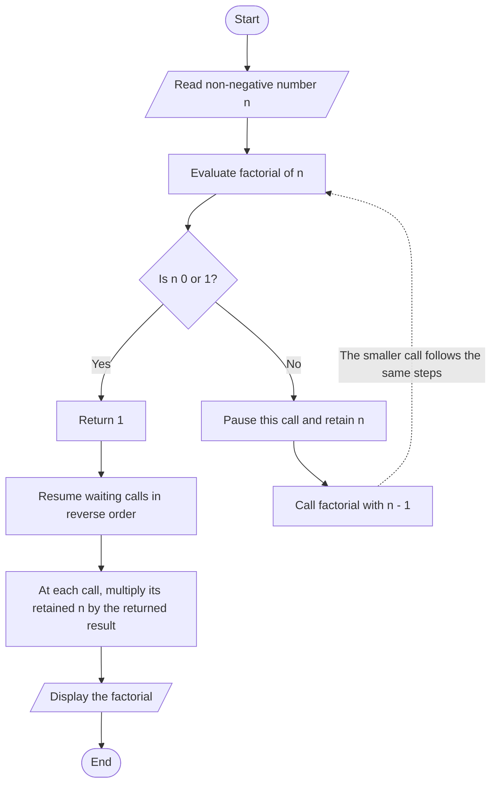

# Lab 19: Recursion, Functions, and String Operations in C

- Topics: recursion, functions, arrays, and string operations.
- Program explanations describe the logic only; they do not reproduce source code.

## What Is Recursion?

- A function calls itself to solve a smaller version of the same problem.
- Each call reduces the input until it reaches a simple case with a direct answer.

- **Base case:** Stops further calls and provides the simplest result.
- **Recursive case:** Reduces the problem and calls the function again with the smaller input.
- **Important:** Without a reachable base case, calls keep accumulating and may exhaust the call stack.

## How Does Recursion Work?

- Every function call has its own input and local state.
- When a function calls itself:
  1. The current call pauses.
  2. The new call works on the smaller input.
  3. When the new call returns, the paused call resumes with its result.
- **Call stack:**
  - Keeps track of paused function calls.
  - Adds each new call to the top of the stack.
  - Removes a call when it finishes, then resumes the call beneath it.
  - Works in last-called, first-finished order.
- **Factorial example:**
  1. Zero and one have factorial `1`.
  2. For a larger number, multiply it by the factorial of the number before it.
  3. For input `4`, calls descend `4 → 3 → 2 → 1`.
  4. The base case returns `1`; waiting calls calculate `2 × 1`, `3 × 2`, then `4 × 6`.
  5. The result is `24`.

## Is Recursion Better?

| Recursion can be a better fit when… | Iteration can be a better fit when… |
| --- | --- |
| A problem naturally consists of smaller versions of itself. | The work is a straightforward repeated operation. |
| The recursive definition makes the logic easier to follow. | The solution needs to use less memory or run with fewer function calls. |
| The problem involves structures such as trees or nested data. | The number of steps is large and recursion depth could become unsafe. |

- Recursion is not always better than iteration; choose the approach that fits the problem.
- Recursion can make a naturally self-similar solution easier to follow.
- Each recursive call uses call-stack space; deep recursion can become unsafe.

## Recursive Factorial: Flow Diagram

- The factorial exercises expect a non-negative input.
- Each non-base call waits for the smaller result, then multiplies it by its own input as it resumes.

- The base case starts the return phase.
- For input `4`, waiting calls multiply the result by `2`, `3`, and `4`, producing `24`.

## Logic of the Lab Programs

### A: Recursion and String Handling

- **A_1 — Factorial**
  1. Read a number.
  2. Find its factorial recursively, using zero or one as the stopping case.
  3. Find it again iteratively by multiplying from one through the input.
  4. Display both results for comparison.
- **A_2 — Print array elements**
  1. Read an array and its size.
  2. Print the current element and move to the next index.
  3. Stop when the index reaches the array size.
  4. Print the elements again using iteration.
- **A_3 — String library operations**
  1. Read two strings.
  2. Measure their lengths and compare them.
  3. Copy, concatenate, reverse, and change letter case using string-handling functions.
  4. Note that operations that modify the first string affect later operations.
- **A_4 — Search for a character**
  1. Search the string for the requested character.
  2. If found, report its first position; otherwise, report that it was not found.
- **A_5 — Replace a character**
  1. Find and replace the first matching character.
  2. Scan the string and replace any remaining matches.
  3. Display the modified string.

### B: Arrays, Combinatorics, and Character Case

- **B_1 — Swap two arrays**
  1. Read both array sizes.
  2. If the sizes differ, report that element-by-element swapping is not possible.
  3. Otherwise, read both arrays and exchange corresponding elements.
  4. Display the resulting arrays.
- **B_2 — Permutations and combinations**
  1. Read `n` and `r`.
  2. Check that both are non-negative and `n` is at least `r`.
  3. Find the required factorials recursively.
  4. Use them to calculate and display `nPr` and `nCr`.
- **B_3 — Convert lowercase letters to uppercase**
  1. Scan the string one character at a time.
  2. Convert lowercase English letters to uppercase; leave other characters unchanged.
  3. Display the resulting string.

### C: Recursive Number Operations

- **C_1 — Reverse a number**
  1. Take the last digit and append it to an accumulator.
  2. Continue with the remaining digits.
  3. When no digits remain, return the accumulated reversed number.
- **C_2 — Find a power**
  1. Use exponent zero as the base case; its result is one.
  2. For a positive exponent, multiply the base by the result for the exponent reduced by one.

## Key Takeaways

- Every recursive solution needs a base case and a recursive case that makes progress toward it.
- The call stack stores paused calls and resumes them as recursive calls return.
- Recursion can express naturally self-similar problems clearly, but it uses call-stack space and is not universally more efficient than iteration.
- Arrays and strings can be processed one element at a time, either by recursion or iteration.
